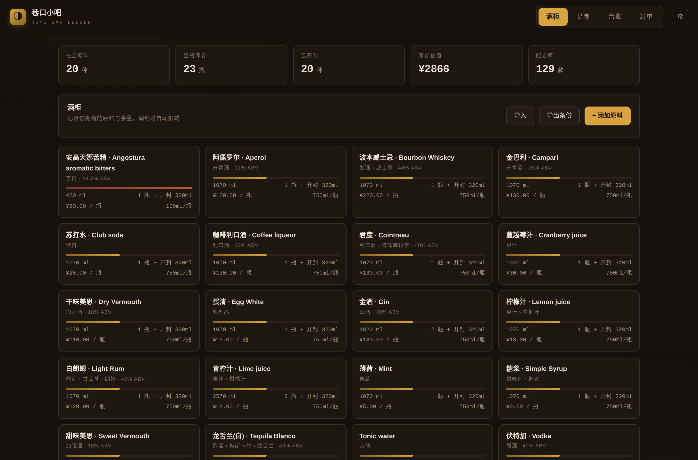
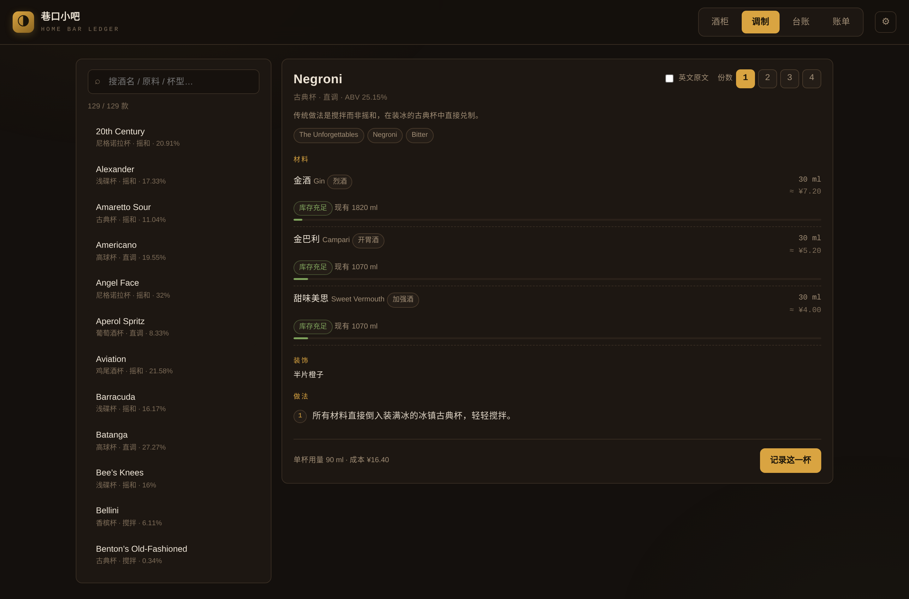
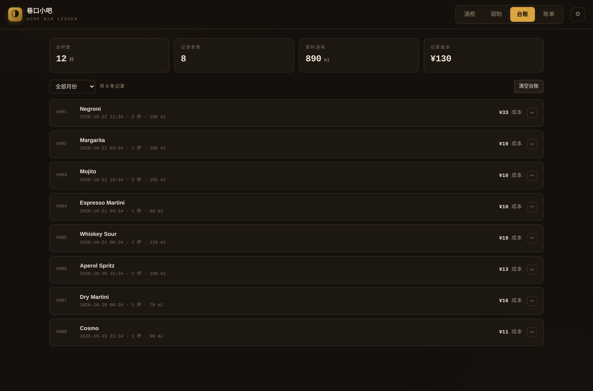
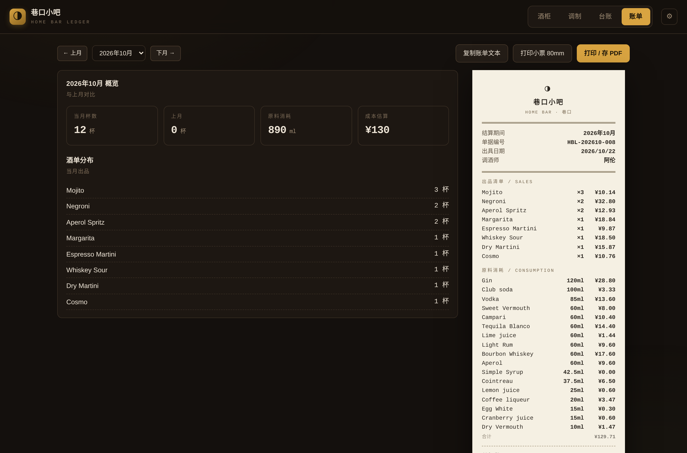
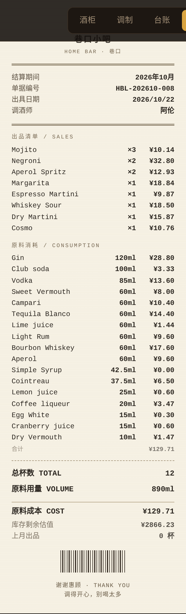
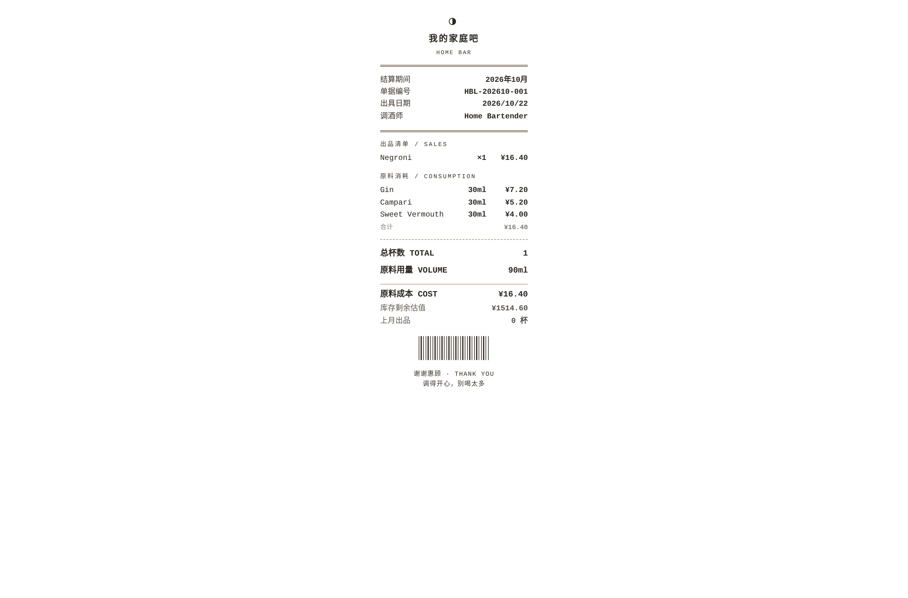
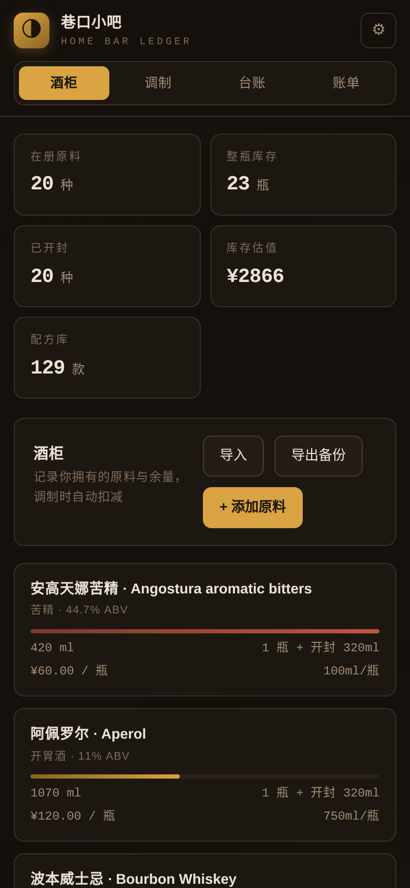

<div align="center">

# 家庭调酒台账 · Home Bar Ledger

**单文件 · 纯前端 · 离线可用的家庭酒吧消耗账本**

记录每一杯酒用了多少料 → 库存自动扣减 → 月底出一张复古酒吧收据

[](https://github.com/your-username/home-bar-ledger/actions/workflows/ci.yml)
[](LICENSE)
[]()

[酒柜](#酒柜) · [调制](#调制) · [台账](#台账) · [账单](#账单) · [在线体验](#在线体验)

</div>

---

## 界面预览

| 酒柜 | 调制 |
|---|---|
|  |  |

| 台账 | 账单 |
|---|---|
|  |  |

<details>
<summary>小票原图 / 移动端 / 打印视图</summary>

**月度小票**



**打印视图（80mm 小票纸）**



**移动端**



</details>

---

## 它是什么

一个**单文件、纯前端、离线可用**的家庭酒吧消耗账本。
打开 `index.html` 就能用 —— 不装环境、不连服务器、不用联网、不需要账号。

**四个页面**

| 页面 | 干什么 |
|---|---|
| **酒柜** | 登记你拥有的原料：整瓶数、规格、单价、开封余量。附「现在能做什么」推荐 |
| **调制** | 129 款经典配方（**全文中文**），实时校验库存够不够，点「记录这一杯」自动扣料 |
| **台账** | 每一杯的历史记录，可按月筛选，一键撤销（原料原样退回酒柜） |
| **账单** | 当月**复古酒吧收据**：出品清单、原料消耗、成本估算。可打印 80mm 小票、存 PDF，或复制成文本发群里 |

---

## 核心逻辑

**扣料**
按配方用量从「已开封余量」扣，不够就自动开新瓶（整瓶数 −1，开封余量 += 瓶容量）。
撤销时按快照精确还原，不会算错账。

**成本**
按 `单价 ÷ 瓶容量 = 每 ml 单价` 摊销。
没标价的原料不计入，会在账单上标注「部分未标价」而不是瞎算。

**可选材料**
装饰类（dash / barspoon / slice 等）不扣库存，单独列在「装饰 / 备料」区。
配方里标了 optional 的材料如果不够，按实际库存扣，不阻断操作。

**中文原料名**
输入「金酒」会自动归一成 `Gin`，不会产生重复条目，也能用中文搜索配方。

**份数**
1–4 杯任意选，用量、成本、库存校验全部联动。

---

## 快速上手

1. 下载或克隆本仓库，双击 `index.html`
2. 进「酒柜」→ 点 **载入常备酒柜**（自动带 15 种常见酒 + 参考价），或手动「添加原料」
3. 进「调制」→ 搜一款酒 → 选份数 → **记录这一杯**
4. 进「账单」→ 选月份 → **打印小票 80mm** / **打印 / 存 PDF** / **复制账单文本**

数据存在浏览器 localStorage（键名 `hbl.v1`）。换设备用「导出备份」/「导入」。

> ⚠️ localStorage 按浏览器 + 文件路径存储。`file://` 打开的数据跟随这个浏览器；
> 想长期稳定保存，建议把 `index.html` 放到固定路径，或定期导出备份。

---

## 在线体验

本项目是纯静态页面，可直接用 GitHub Pages 托管：

1. 仓库 **Settings → Pages**
2. **Source** 选 `Deploy from a branch`，分支选 `main`、目录选 `/ (root)`
3. 打开 `https://<用户名>.github.io/home-bar-ledger/`

> 注意：走 http(s) 域名时，localStorage 按域名隔离，换域名数据不通 —— 用「导出备份」迁移。

---

## 数据来源

- **配方与原料数据**：[bar-assistant/data](https://github.com/bar-assistant/data) —— MIT 协议。
  从 663 款开源配方中精选 129 款经典
  （`IBA Cocktail` / `The Unforgettables` / `Contemporary Classics` / `New Era Drinks`），
  归一化单位为 ml，补充了 114 种原料的中文名、分类中文与参考价。详见 [`data/README.md`](data/README.md)。
- **中文翻译**：描述、做法、装饰、杯型、技法由本项目翻译，配方详情页可勾选「英文原文」对照查看。
- **参考价**：预置的是国内常见规格的粗略估价，**在酒柜里可以随意改成你的真实价格**。
- **灵感与参考**：
  [Bar Assistant](https://github.com/karlomikus/bar-assistant)（MIT）、
  [Salt Rim](https://github.com/karlomikus/vue-salt-rim)（MIT）、
  [printtemplate](https://github.com/ztyoper/printtemplate)（Apache-2.0，小票排版参考）、
  [Co-Invoice](https://github.com/mraxays/co-invoice)（CC BY-NC 4.0，模板与打印架构参考）。

---

## 目录结构

```
index.html              ← 成品，双击就能用
bar-data.json           ← 配方数据集（可单独取用 / 二次开发）
LICENSE                 ← MIT
preview/                ← 界面截图
build/
  build_data.py         ← 从 bar-assistant/data 抽取 + 归一化 + 中文化
  translations.py       ← 129 款配方的中文翻译
  app.template.html     ← 应用源码（数据以 /*__DATA__*/ 占位）
  compile.py            ← 注入数据 → index.html
  test.js               ← 85 项逻辑测试（jsdom）
  browser-test.js       ← 真实浏览器验证（file:// 直开 / 打印 / 持久化）
  shots.js              ← 截图
data/                   ← 上游基础词表 + Schema + 出处说明
.github/workflows/ci.yml ← CI：构建校验 + 测试 + 截图
```

**重新构建**

```bash
npm install                    # 只装测试依赖（jsdom / playwright），运行应用本身零依赖
python3 build/compile.py       # → index.html
npm test                       # 85 项逻辑测试
npm run test:browser           # 真实浏览器端到端
```

---

## 测试覆盖

85 项 jsdom 逻辑测试 + 真实 Chromium 端到端验证，CI 每次 push 自动跑：

- 启动 / 空状态 / 无 JS 报错
- 配方库完整性（129 款、材料字段合法）
- 原料入库、中文名归一（`金酒` → `Gin`）
- 缺料拦截、可选材料按实扣
- 扣减正确性（开封余量、跨瓶开新瓶）
- 成本计算（90ml × ¥0.2/ml = ¥18.00）
- 撤销精确还原
- 月度账单渲染（出品清单 / 原料消耗 / 合计 / 条形码 / 落款）
- 份数联动（1 份 90ml / 3 份 270ml）
- 搜索（酒名 / 英文原料 / 中文原料）
- 导入导出、设置持久化
- `file://` 直开可用、localStorage 可用、刷新后数据仍在
- 打印媒体样式（顶栏与 toast 隐藏、条形码正常）

---

## 许可

本项目代码以 [MIT](LICENSE) 协议开源。
配方数据源自 [bar-assistant/data](https://github.com/bar-assistant/data)（MIT），分发时请保留原始出处。
